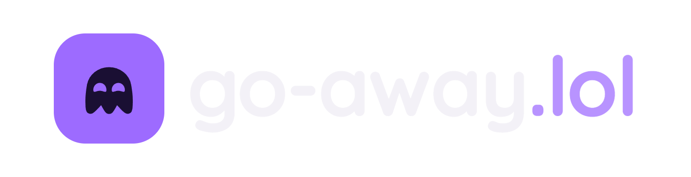

  

<h3 align="center">Privacy tools that work for you, not for advertisers.</h3>

  <a href="https://go-away.lol"><b>Website</b></a> ·
  <a href="mailto:security@go-away.lol"><b>Report a security issue</b></a>

---

## What we build

**go-away.lol** makes everyday internet tools that respect you: no ads, no tracking, no data to sell.
Free, with every feature, for everyone.

## Products

| | Product | What it does | Status |
| --- | --- | --- | --- |
| ✉️ | **[GoAway Mail](https://go-away.lol)** | Email locked on your device before it leaves. Aliases on `dont-drink.beer` and `hopinmy.boats` to hide your real address. | **Live** |

More tools will join, with the same promise.

## What every go-away.lol product promises

- **We can't sell what we can't read.** Wherever possible, your data is locked on your device with a key only you hold.
- **No ads, no trackers, no profiling.** Not in our apps, not on our websites.
- **Free for everyone.** No premium tier hiding the features that protect you.
- **Honest about limits.** If something isn't private, we say so, right where you see it.
- **Open code.** You don't have to take our word for it.

## Repositories

| Repository | What's inside |
| --- | --- |
| [**Go-Away.lol**](https://github.com/linuxlts/Go-Away.lol) | The website and GoAway Mail: app, mail server (Cloudflare Worker) and database. |

New products get their own repository here as they ship.

## Security

Found a vulnerability in any of our products? Write to **security@go-away.lol**, and please give us time to fix it
before going public. There's no cash reward: you get our thanks, and a signed certificate congratulating you.

Made with care, and a ghost 👻 · <a href="https://go-away.lol">go-away.lol</a>

